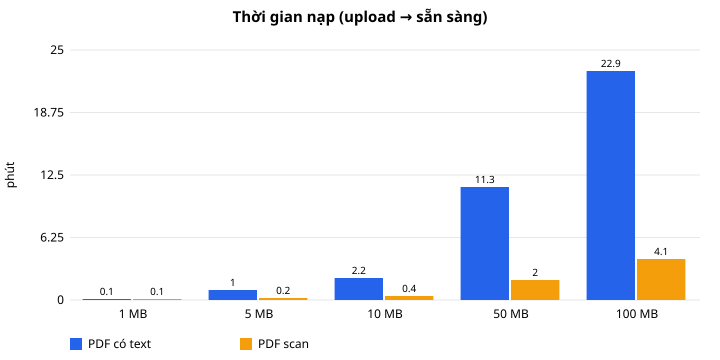
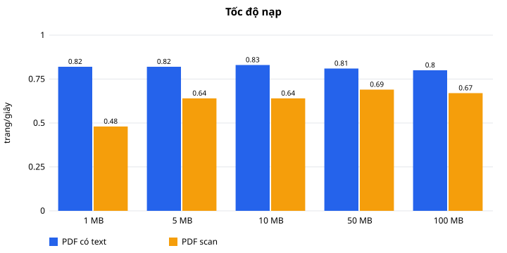
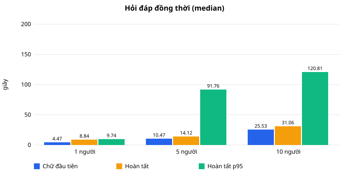
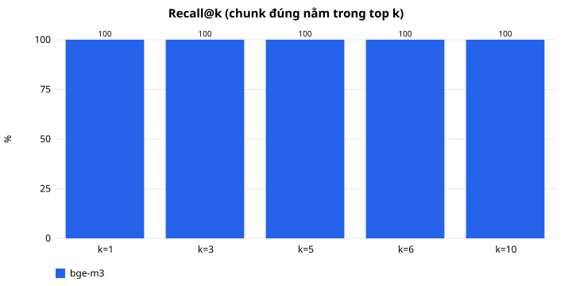

# Báo cáo benchmark — Giai đoạn 5 (30/09/2026)

Số liệu thô: [stage5_ingest.json](stage5_ingest.json), [stage5_qa_load.json](stage5_qa_load.json),
[stage5_quality.json](stage5_quality.json). Biểu đồ: [charts/](charts/). Các giai đoạn trước:
[baseline.md](baseline.md), [stage2.md](stage2.md), [stage3.md](stage3.md).

## 1. Máy và cấu hình đã đo

| Thành phần | Giá trị |
|---|---|
| CPU | Intel Core i5-12500H (12 nhân / 16 luồng), laptop |
| RAM | 15,7 GB; Docker Desktop (WSL2) được cấp 7,6 GB, 16 CPU |
| GPU | NVIDIA RTX 3050 Ti Laptop 4 GB (driver 610.62) — **chỉ Ollama dùng**; backend dùng torch CPU |
| OS | Windows 11 + Docker Desktop, Ollama 0.34.4 trên host |
| Backend | Python 3.11.16, torch 2.14.0+cpu, Tesseract 5 (`vie`), PostgreSQL 17, SeaweedFS 4.48, Chroma 1.5.9, Redis 8 |
| Embedding | `BAAI/bge-m3` (1024 chiều), chunk 512 token / overlap 64, CPU |
| LLM | `qwen2.5:7b` (Q4, ~4,7 GB) qua `/v1/chat/completions`, ngữ cảnh 8192, TOP_K 6, temperature 0,2 |
| OCR | Tesseract, 4 trang song song (`OCR_WORKERS=4`), 200 dpi |

## 2. Bộ file test

`scripts.benchmark.make_corpus` (cố định, tái tạo được): PDF tiếng Việt ~1/5/10/50/100 MB, hai loại:

- **PDF có text**: mỗi trang ~18 câu văn bản (≈ 1 chunk 512 token) + 1 ảnh minh họa JPEG (~90 KB) — lý do thường gặp
  khiến PDF thật nặng. 7 → 1 102 trang.
- **PDF scan**: ảnh trang A4 200 dpi có nhiễu, không có text layer (bắt buộc OCR). 2 → 166 trang.

Đo qua endpoint upload thật (`POST /api/documents`), job chạy đúng mã của worker (inline, DB/bucket/Chroma scratch).

## 3. Ingest (upload → sẵn sàng hỏi đáp)

| File | MB | Trang | Tổng | Trang/giây | Đọc + OCR | Embedding | RAM đỉnh | CPU TB (lõi) |
|---|---:|---:|---:|---:|---:|---:|---:|---:|
| text 1 MB | 1,0 | 7 | 8,6 s | 0,82 | 0,1 s | 8,3 s | 1,1 GB | 7,7 |
| text 5 MB | 5,0 | 51 | 62,5 s | 0,82 | 0,4 s | 61,9 s | 1,6 GB | 7,9 |
| text 10 MB | 10,0 | 107 | 2 ph 9 s | 0,83 | 0,7 s | 128 s | 1,7 GB | 7,9 |
| text 50 MB | 49,7 | 550 | 11 ph 18 s | 0,81 | 4,2 s | 671 s | 2,3 GB | 7,9 |
| text 100 MB | 99,3 | 1 102 | 22 ph 54 s | 0,80 | 8,1 s | 1 358 s | 2,8 GB | 7,9 |
| scan 1 MB | 1,2 | 2 | 4,2 s | 0,48 | 2,4 s | 1,6 s | 1,2 GB | 4,1 |
| scan 5 MB | 5,5 | 9 | 14,0 s | 0,64 | 7,4 s | 6,5 s | 1,6 GB | 5,2 |
| scan 10 MB | 10,3 | 17 | 26,6 s | 0,64 | 12,3 s | 14,1 s | 1,7 GB | 5,7 |
| scan 50 MB | 50,3 | 83 | 2 ph 0 s | 0,69 | 51,6 s | 67,6 s | 2,3 GB | 6,1 |
| scan 100 MB | 100,5 | 166 | 4 ph 8 s | 0,67 | 106 s | 136 s | 3,0 GB | 6,0 |

Nhận xét:

- **Thời gian tỉ lệ với số trang (số chunk), không với MB.** PDF text: 1,21–1,25 s/trang, gần như toàn bộ là embedding
  bge-m3 trên CPU (~0,8 chunk/s, dùng hết ~8 lõi). PDF scan: ~1,5 s/trang = OCR 0,6–0,8 s/trang (4 luồng) + embedding.
  Các bước chunk, ghi Chroma, ghi PostgreSQL, tải file: < 1% tổng thời gian.
- RAM đỉnh (cả container: model bge-m3, PyMuPDF, Tesseract, Chroma local của lần đo) tăng từ 1,1 lên 3,0 GB theo kích thước file.
- GPU: 0% trong ingest (image backend là torch CPU; GPU 4 GB dành cho LLM).
- Model embedding nạp một lần khi worker khởi động: 22 s.

### Dung lượng sinh ra

| Nơi lưu | Dung lượng | Ghi chú |
|---|---|---|
| Object storage (SeaweedFS) | **1,00 ×** file gốc | lưu nguyên file |
| PostgreSQL | ~1,6 KB / chunk | text chunk, vị trí ký tự, bounding box (JSONB), index |
| Chroma | ~27 KB / chunk | vector 1024 chiều + HNSW + bản sao text/metadata |

Ví dụ: text 100 MB (1 102 chunk) → S3 99 MB + PostgreSQL 1,9 MB + Chroma 36 MB ≈ **1,4 ×** file gốc;
scan 100 MB (166 chunk) → ≈ **1,05 ×**. Ước lượng chung: `dung lượng file + ~30 KB × số trang`.

### Ước lượng cho file lớn hơn (máy này, CPU embedding)

`thời gian ≈ 1,25 s × số trang (PDF text)`; `≈ 1,5 s × số trang (PDF scan)`; trang dày chữ (> 512 token) tạo
~1,5 chunk/trang → ~1,8 s/trang.

| Số trang | PDF text | PDF scan |
|---:|---:|---:|
| 300 | ~6 ph | ~7,5 ph |
| 1 000 | ~21 ph | ~25 ph |
| 2 000 | ~42 ph | ~50 ph |
| 2 900 | ~60 ph = `INGEST_JOB_TIMEOUT_SECONDS` mặc định | — |

Một worker xử lý tuần tự: file 1 000 trang chặn mọi upload khác ~20 phút.
Có GPU riêng cho embedding (wheel torch CUDA) thì bước embedding nhanh hơn nhiều lần — **chưa đo** trên máy này
vì GPU 4 GB đã dành cho LLM.

## 4. Hỏi đáp đồng thời

`scripts.benchmark.bench_load`: N người gửi cùng lúc `POST /api/chat` (SSE qua HTTP thật) trên PDF benchmark 36 trang;
6 câu luân phiên (4 fact, 1 câu cần liệt kê dài, 1 câu không có trong tài liệu). Model đã nạp sẵn.

| Người dùng đồng thời | Chữ đầu tiên (median / p95) | Hoàn tất (median / p95) | Token/s mỗi người (median) | Token/s tổng | Lỗi |
|---:|---:|---:|---:|---:|---:|
| 1 (3 câu nối tiếp) | 4,5 s / 5,3 s | 8,8 s / 9,7 s | 7,0 | — | 0 |
| 5 | 10,5 s / 23,3 s | 14,1 s / 91,8 s | 6,6 | 6,0 | 0 |
| 10 | 25,5 s / 45,8 s | 31,1 s / 120,8 s | 6,1 | 5,9 | 0 |

- Ollama phục vụ **tuần tự** (một yêu cầu một lúc): chữ đầu tiên của người thứ k đến sau khi k−1 câu trước sinh xong
  (1,7 → 7 → 10 → 16 → … → 46 s ở mức 10 người). Tổng thông lượng không tăng theo số người (~6 token/s).
- p95 "hoàn tất" bị kéo dài bởi câu trả lời dài (~450 token ≈ 70 s sinh chữ).
- GPU: dùng đỉnh 98%, trung bình 19%; VRAM 3,85/4 GB — `qwen2.5:7b` **không vừa hết 4 GB** nên một phần lớp chạy trên CPU,
  vì vậy chỉ ~7 token/s. API container: ~1,4 GB RAM, CPU gần như rảnh (retrieval ~0,1–0,2 s/câu).
- Retrieval, rewrite, lưu lịch sử không phải nút thắt; **LLM là nút thắt duy nhất khi nhiều người hỏi.**

So sánh cùng bài đo với `qwen2.5:3b` (vừa trọn 4 GB VRAM, [stage5_qa_load_3b.json](stage5_qa_load_3b.json)):

| Người dùng đồng thời | Chữ đầu tiên (median / p95) | Hoàn tất (median / p95) | Token/s mỗi người | Token/s tổng |
|---:|---:|---:|---:|---:|
| 1 | 1,6 s / 1,7 s | 1,8 s / 2,0 s | 73,5 | — |
| 5 | 1,8 s / 4,1 s | 2,0 s / 7,9 s | 74,6 | 45,0 |
| 10 | 2,8 s / 7,5 s | 3,2 s / 7,7 s | 73,8 | 47,8 |

Nhanh hơn ~10 lần nhưng **chất lượng kém hơn rõ** (mục 5: 64,5% so với 96,8%) → giữ `qwen2.5:7b` làm model trả lời;
3b chỉ dùng cho bước tóm tắt từng phần (`LLM_SUMMARY_MODEL`) hoặc máy không có GPU.

## 5. Chất lượng

`scripts.evaluate` với LLM thật, 39 câu: 25 câu của bộ evaluation (PDF text, PDF scan, ảnh, DOCX, Excel; tiếng Việt và
tiếng Anh) + 14 câu trên PDF đề bài thật của người dùng (câu hỏi/đáp án chỉ lưu local ở `evaluation/custom/`).
31 câu có đáp án, 8 câu tài liệu không có thông tin (đúng = từ chối, không nguồn).

| Chỉ số | `qwen2.5:7b` (mặc định) | `qwen2.5:3b` |
|---|---:|---:|
| Recall@1 / @3 / @5 / @6 / @10 (chunk đúng trong top k) | 100% / 100% / 100% / 100% / 100% | (cùng retrieval) |
| MRR | 1,00 | |
| Trả lời đúng (đúng từ khóa **và** trích đúng nguồn), 31 câu | **30/31 (96,8%)** | 20/31 (64,5%) |
| — trong đó PDF của người dùng, 10 câu | 9/10 | 2/10 |
| Từ chối đúng khi không có thông tin, 8 câu | **7/8 (87,5%)** | 7/8 |
| Tổng | **37/39 (94,9%)** | 27/39 (69,2%) |
| Lỗi dịch vụ | 0 | 0 |

Hai câu sai của 7b:
- Một câu diễn đạt lại trên PDF người dùng: trả lời đúng 2 đặc điểm có trích dẫn nhưng thiếu các đặc điểm còn lại (nói rõ
  "tài liệu không có đủ thông tin" cho phần thiếu) — trả lời thiếu, không bịa.
- "Hạn chót nộp bài là ngày nào?" (không có trong PDF đề bài): model trả lời hạn đăng ký 10/10 của **một tài liệu khác
  trong cùng kho** (`notice.png`, có trích dẫn). Câu hỏi không chỉ rõ tài liệu; trong giao diện, chọn phạm vi tài liệu
  sẽ tránh được. Đếm là sai.

Điểm số tương đồng: chunk đúng thấp nhất 0,47, câu không có đáp án cao nhất 0,56 — **chồng lấn**, nên ngưỡng cứng 0,55
(cũ) chỉ giữ 84% chunk đúng; xác nhận quyết định Top-K + để LLM quyết định.

Bộ câu hỏi riêng của người dùng (30–50 câu): mẫu `evaluation/custom_questions.example.json`, cách chạy trong README
("Phát triển") — chưa có dữ liệu, sẽ chạy khi người dùng bổ sung.

## 6. Đề xuất

### Giới hạn upload (đã áp dụng ở Giai đoạn 6)

| Biến | Giá trị | Lý do |
|---|---:|---|
| `MAX_PDF_PAGES` | **300** | Trường hợp xấu nhất ~6 ph (text) / ~7,5 ph (scan) trên máy này; không chặn hàng đợi quá lâu. |
| `MAX_UPLOAD_MB` | **100** | File scan 100 MB (~166 trang 200 dpi) xử lý trong ~4 ph, RAM đỉnh 3 GB; PDF text nặng vì ảnh vẫn bị chặn bởi số trang. |
| nginx `client_max_body_size` | 105m | MAX_UPLOAD_MB + phần đầu multipart. |
| Loại file | PDF, DOCX, XLS/XLSX, PNG/JPG/JPEG | Theo phần mở rộng (các loại khác bị từ chối 415). |

Tài liệu dài hơn: tách thành nhiều file ≤ 300 trang (hoặc tăng `MAX_PDF_PAGES` trên máy có GPU cho embedding).

### Cấu hình máy

| | Tối thiểu (dùng thử, 1–3 người) | Khuyến nghị (5–10 người nội bộ) |
|---|---|---|
| CPU | 4 nhân / 8 luồng (ingest chậm ~2×: ~2,5 s/trang) | 8+ nhân / 16 luồng |
| RAM | 16 GB: Docker ≥ 6 GB (worker ≤ 3 GB, api ~1,5–2,5 GB, DB/storage ~0,5 GB) + LLM | 32 GB |
| GPU cho LLM | Không bắt buộc; CPU-only chỉ hợp với `qwen2.5:3b` | NVIDIA ≥ 8 GB VRAM để `qwen2.5:7b` nằm trọn trên GPU, `OLLAMA_NUM_PARALLEL=2–4` |
| Ổ đĩa | SSD, 20 GB + ~1,4 × tổng dung lượng tài liệu | SSD NVMe |

Với 10 người hỏi cùng lúc, thời gian chờ chữ đầu tiên chỉ giảm khi LLM nhanh hơn/song song:
GPU lớn hơn, server LLM riêng (vLLM/Ollama trên máy GPU — xem README "Chuyển LLM"), hoặc model nhỏ hơn.
